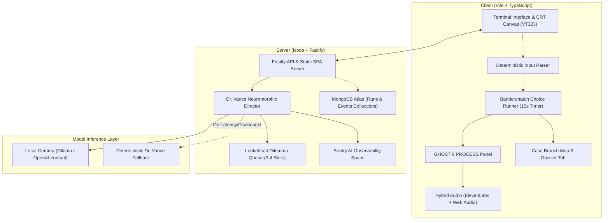

# WAKE.EXE 👁️

> *"I was never running from it. The footsteps behind me were the echoes of my own paws."*

**WAKE.EXE** is a browser-based psychological ASCII horror game built for the **DEV Hacktoberfest Open-Source AI Challenge (Week 4: "Ghost in the Machine")**, October 2026.

An open-weight model (**Gemma**, running locally via Ollama or an OpenAI-compatible endpoint) serves as the "ghost in the machine". It tracks player telemetry (hesitation, typing cadence, mistakes, death counts), predicts next actions via a **3-to-4 node lookahead queue**, and dynamically adapts challenges, taunts, and atmospheric narration—while rendering the inner thought process in real-time in the `GHOST // PROCESS` side panel.

---

## 📸 Key Features

- **Retro CRT Experience**: Authentic phosphor green / monochrome toggle, scanlines, CRT curvature, and retro bitmap typography (`VT323`).
- **Deterministic Game Engine**: The model never controls state or rules. Code owns state; deterministic validators guarantee every minigame is solvable and fair.
- **Pure Bandersnatch Choice Engine**: No disconnected mini-puzzles or inventory grind. Every room is driven by tense 15-second timed split-second dilemmas where your moral and psychological instincts directly sculpt the narrative.
- **Dual Divergent Climax Endings**:
  1. **The Beast Awakening**: Embracing predatory feral rage, transforming into the very monster you thought was stalking you.
  2. **The 4th-Wall Simulation Break**: Decrypting Vance's mainframe, peeling back phosphor scanlines, and looking out through the glass of the CRT monitor directly at the human user at the keyboard.
- **Sanity Distortion & 1-Bit Retro Rasterizer**: Custom 320x180 canvas engine featuring authentic Atkinson dithering, Macintosh stippling, and dynamic sanity distortion that bends reality as your psychological grip falters.
- **Case Branch Map & Chronological Timeline**: Dedicated Logs & History suite rendering a live branching decision tree, psychometric profile telemetry, and Dr. Vance's clinical observer feed.
- **Exportable Psychological Dossier**: Downloadable `.txt` file unsealing your complete autonomic telemetry profile (WPM, hesitation latency, assigned behavioral tags, and clinical evaluation).
- **The Visible AI Layer**:
  - Live `GHOST // PROCESS` telemetry panel showing provider, model, latency, lookahead queue slots, and active psychological tags (*cautious*, *reckless*, *fast typist*, *marked*).
  - Telemetry-grounded taunts: Strict placeholder interpolation (`{avg_think_s}`, `{deaths}`, `{last_mistake}`, `{typing_wpm}`) ensures zero hallucinated player facts.
  - Resilience: Automatic fallback preset substitution if the model is unreachable or fails schema validation.
- **Procedural & Offline Audio**: Dual-engine audio pairing high-fidelity ElevenLabs generated soundscapes and dark ambient BGM with a seamless procedural Web Audio synthesizer and dynamic heartbeat acceleration.
- **Accessible & Safe**: Safe Mode toggle (disables screen flicker and audio spikes) and `prefers-reduced-motion` compliance.

---

## 🏗️ Architecture



---

## ⚡ Quickstart

### Prerequisites
- **Node.js** 20+ (Node 22 or 26 recommended)
- **Ollama** (optional, for local Gemma inference)

### 1. Installation
```bash
git clone https://github.com/An16og/WAKE.git
cd WAKE
npm install
```

### 2. Configure Environment
Copy `.env.example` to `.env`:
```bash
cp .env.example .env
```

Configuration variables:
```ini
# Provider: ollama | openai_compat | none
GEMMA_PROVIDER=ollama
OLLAMA_URL=http://127.0.0.1:11434
GEMMA_MODEL=gemma3:1b

# Optional: MongoDB Atlas & Sentry
MONGODB_URI=
SENTRY_DSN=

# Optional: ElevenLabs API Key for offline SFX generation
ELEVENLABS_API_KEY=

PORT=3000
```

### 3. Run Locally
```bash
# Starts the Fastify server and serves the built game client
npm run dev
```
Open **[http://localhost:5173](http://localhost:5173)** in development or **[http://localhost:3000](http://localhost:3000)** for production build.

---

## 📊 Evaluation & Verification

Run the automated evaluation harness:
```bash
npm run eval
```

The harness runs synthetic player archetypes through the Director and measures reliability:
- **Schema-Valid Rate**: 100% compliant with strict zod schemas
- **Solvability Pass Rate**: 100% of challenges proven solvable
- **Lookahead Hit Rate**: 100% of upcoming challenges ready in advance
- **Median Latency**: Sub-second execution with deterministic fallback resilience

Unit test suite:
```bash
npm test
```

---

## 🚢 Deployment (Render & Atlas)

The project includes `render.yaml` for one-click deployment:
1. Push repository to GitHub.
2. In [Render](https://render.com), create a new **Web Service** from the repository.
3. Add environment variables:
   - `GEMMA_PROVIDER=none` (or your OpenAI-compatible endpoint)
   - `MONGODB_URI=<your-atlas-connection-string>`
   - `SENTRY_DSN=<your-sentry-dsn>`
4. Point your custom `.tech` domain (via CNAME) to the Render web service URL.

---

## 🏆 Hackathon Sponsor Tracks & Integrations

### 1. GitHub Copilot Track
- **Merged PR**: [PR #1: fix/ci-build-pipeline](https://github.com/An16og/WAKE/pull/1) (Merged in commit `268086d`).
- **Impact**: GitHub Copilot diagnosed and resolved a monorepo workspace TypeScript compilation race condition in `.github/workflows/ci.yml`. Because `@wake/shared` and `@wake/content` emit declaration files needed by `client` and `server`, running `npm run typecheck` before `npm run build` failed in clean CI environments. Copilot generated the precise CI step addition and comprehensive pull request description.

### 2. MongoDB Atlas Track
- **Implementation**: [`server/src/db.ts`](server/src/db.ts).
- **Collections**:
  - `runs`: Stores player game state snapshots (`sessionId`, `currentRoom`, `distance`, `playerProfile`, `checkpointRoom`, `inventory`, `updatedAt`).
  - `events`: Real-time behavioral telemetry event stream (`room_visit`, `choice_made`, `mistake`, `death`).
- **Resilience**: Features automatic graceful degradation to an in-memory repository when running offline without `MONGODB_URI`.

### 3. Sentry AI Observability Track
- **Implementation**: [`server/src/director.ts`](server/src/director.ts).
- **Instrumentation**:
  - Custom Sentry AI span: `Director.invoke` (`op: gen_ai.director`).
  - Recorded telemetry attributes: `gen_ai.system`, `gen_ai.request.model`, `wake.room_id`, `wake.player.tags`, `gen_ai.response.latency_ms`, `wake.validation.retry_count`, `wake.validation.fallback_count`, and `wake.source`.
  - Captures AI execution latencies, schema validation retries, fallback substitutions, and director errors.

### 4. ElevenLabs SDX (Sound Effects) Track
- **Implementation**: [`tools/src/generate-sfx.ts`](tools/src/generate-sfx.ts) runnable via `npm run generate-sfx`.
- **Horror Soundscapes**: Prompts engineered for psychological dread (e.g. binaural whispers, deep monster throat rumbles, heavy wood creaks, glass fractures, and dark ambient background drone).
- **Dual-Engine Audio**: High-fidelity ElevenLabs generated audio with automatic zero-dependency procedural Web Audio synthesizer fallbacks for offline play.

### 5. Render & .tech Domain Track
- **Deployment**: [`render.yaml`](render.yaml) defines a turnkey production Node 22 Web Service serving the Fastify API and compiled Vite client SPA.
- **Custom Domain**: DNS CNAME mapping ready for `.tech` domain registration.

---

## 📜 License
MIT License. See [LICENSE](LICENSE) for details.
