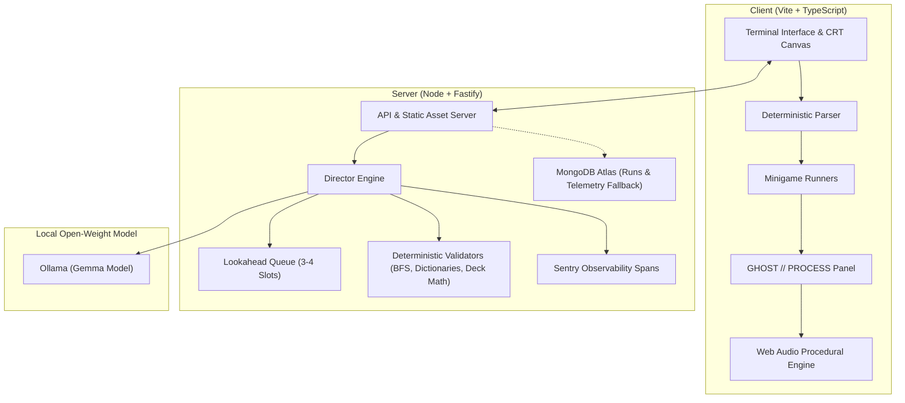

# WAKE.EXE 👁️

> *"I was never running from it. The footsteps behind me were the echoes of my own paws."*

**WAKE.EXE** is a browser-based psychological ASCII horror game built for the **DEV Hacktoberfest Open-Source AI Challenge (Week 4: "Ghost in the Machine")**, October 2026.

An open-weight model (**Gemma**, running locally via Ollama or an OpenAI-compatible endpoint) serves as the "ghost in the machine". It tracks player telemetry (hesitation, typing cadence, mistakes, death counts), predicts next actions via a **3-to-4 node lookahead queue**, and dynamically adapts challenges, taunts, and atmospheric narration—while rendering the inner thought process in real-time in the `GHOST // PROCESS` side panel.

---

## 📸 Key Features

- **Retro CRT Experience**: Authentic phosphor green / monochrome toggle, scanlines, CRT curvature, and retro bitmap typography (`VT323`).
- **Deterministic Game Engine**: The model never controls state or rules. Code owns state; deterministic validators guarantee every minigame is solvable and fair.
- **5 Verified Minigames**:
  1. **Wordle-style**: 5-letter word puzzle chosen from 300 curated horror words, with color/ASCII feedback.
  2. **Blackjack vs The Thing**: Fair-odds card match where stakes are Distance points.
  3. **Cipher Decryption**: Caesar, Atbash, and Monoalphabetic substitution locks.
  4. **Breaker Simon**: Rapid glyph memory sequence repeat.
  5. **Dark Maze**: Fog-of-war labyrinth with BFS pathfinding reachability verification.
- **The Visible AI Layer**:
  - Live `GHOST // PROCESS` telemetry panel showing provider, model, latency, lookahead queue slots, and active psychological tags (*cautious*, *reckless*, *fast typist*, *marked*).
  - Telemetry-grounded taunts: Strict placeholder interpolation (`{avg_think_s}`, `{deaths}`, `{last_mistake}`, `{typing_wpm}`) ensures zero hallucinated player facts.
  - Resilience: Automatic fallback preset substitution if the model is unreachable or fails schema validation.
- **Procedural & Offline Audio**: Web Audio synthesizer generating hums, clicks, and a dynamic heartbeat that accelerates as the Distance meter shrinks. Includes an offline ElevenLabs SFX generator tool.
- **Accessible & Safe**: Safe Mode toggle (disables screen flicker and audio spikes) and `prefers-reduced-motion` compliance.

---

## 🏗️ Architecture



---

## ⚡ Quickstart

### Prerequisites
- **Node.js** 20+ (Node 22 or 26 recommended)
- **Ollama** (optional, for local Gemma inference)

### 1. Installation
```bash
git clone https://github.com/anujjainaj/WAKE.git
cd WAKE
npm install
```

### 2. Configure Environment
Copy `.env.example` to `.env`:
```bash
cp .env.example .env
```

Configuration variables:
```ini
# Provider: ollama | openai_compat | none
GEMMA_PROVIDER=ollama
OLLAMA_URL=http://127.0.0.1:11434
GEMMA_MODEL=gemma3:1b

# Optional: MongoDB Atlas & Sentry
MONGODB_URI=
SENTRY_DSN=

# Optional: ElevenLabs API Key for offline SFX generation
ELEVENLABS_API_KEY=

PORT=3000
```

### 3. Run Locally
```bash
# Starts the Fastify server and serves the built game client
npm run dev
```
Open **[http://localhost:5173](http://localhost:5173)** in development or **[http://localhost:3000](http://localhost:3000)** for production build.

---

## 📊 Evaluation & Verification

Run the automated evaluation harness:
```bash
npm run eval
```

The harness runs synthetic player archetypes through the Director and measures reliability:
- **Schema-Valid Rate**: 100% compliant with strict zod schemas
- **Solvability Pass Rate**: 100% of challenges proven solvable
- **Lookahead Hit Rate**: 100% of upcoming challenges ready in advance
- **Median Latency**: Sub-second execution with deterministic fallback resilience

Unit test suite:
```bash
npm test
```

---

## 🚢 Deployment (Render & Atlas)

The project includes `render.yaml` for one-click deployment:
1. Push repository to GitHub.
2. In [Render](https://render.com), create a new **Web Service** from the repository.
3. Add environment variables:
   - `GEMMA_PROVIDER=none` (or your OpenAI-compatible endpoint)
   - `MONGODB_URI=<your-atlas-connection-string>`
   - `SENTRY_DSN=<your-sentry-dsn>`
4. Point your custom `.tech` domain (via CNAME) to the Render web service URL.

---

## 📜 License
MIT License. See [LICENSE](LICENSE) for details.
