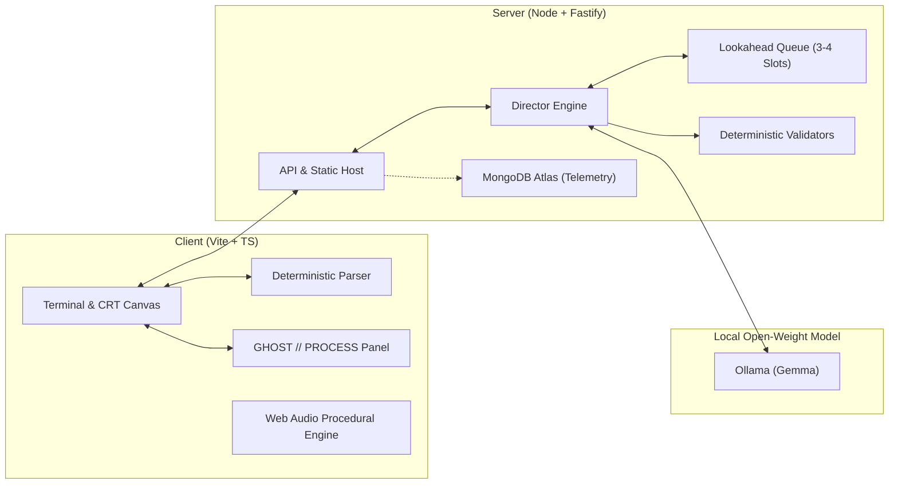

# WAKE.EXE 👁️

> **"I was never running from it."**

A browser-based ASCII/pixel psychological horror game where an open-weight model (**Gemma**, running locally via Ollama) plays the "ghost in the machine". It tracks your telemetry, predicts your movements, and dynamically adapts challenges, taunts, and environmental narration—while making the machine's inner thought process visible in real time.

Built for the **DEV Hacktoberfest Open-Source AI Challenge (Week 4: "Ghost in the Machine")**, October 2026.

---

## 🎮 The Experience

- **Retro CRT Aesthetic**: Phosphor green / monochrome terminal, scanlines, CRT curve, and authentic terminal typography.
- **Pure Deterministic Engine**: Fast, responsive text parser and verified minigames (Wordle, Blackjack vs The Thing, Ciphers, Glyph Simon, Dark Maze). Code owns the state; the model never blocks the game loop.
- **The Director (Visible AI)**:
  - Bandersnatch-style 3-to-4 node lookahead queue.
  - Live side panel: `GHOST // PROCESS` displays model status, latency, real-time player tagging (e.g., *cautious*, *reckless*, *fast typist*), and lookahead queue slots.
  - Telemetry-grounded taunts: The model fills strict schema slots with real numbers (hesitation seconds, death count, mistake type) so it never hallucinates player facts.
  - Resilient fallback engine: If the model is offline (`GEMMA_PROVIDER=none`), unresponsive, or produces invalid schemas, fallback presets kick in seamlessly without stalling play.
- **Procedural & Offline Audio**: Web Audio synth for ambient room hum, heartbeat synced to distance, and key clicks, augmented with offline-generated sound design.
- **Accessible & Safe**: Safe Mode toggle (disables screen flicker and audio jumpscares) and `prefers-reduced-motion` compliance.

---

## 📐 Architecture



---

## 🚀 Quickstart

### Prerequisites
- Node.js 20+ (Node 22 or 26 recommended)
- [Ollama](https://ollama.com/) (optional, for local Gemma inference)

### 1. Clone & Install
```bash
git clone https://github.com/anujjainaj/WAKE.git
cd WAKE
npm install
```

### 2. Configure Environment
Copy the example environment file:
```bash
cp .env.example .env
```

Settings in `.env`:
```ini
GEMMA_PROVIDER=ollama         # or 'none' for pure deterministic fallback mode
OLLAMA_URL=http://127.0.0.1:11434
GEMMA_MODEL=gemma3:1b         # or gemma2:2b / your chosen Gemma model
PORT=3000
```

### 3. Setup Ollama (Local AI)
If using Ollama:
```bash
ollama pull gemma3:1b
```

### 4. Run Locally
```bash
npm run dev
```
Open [http://localhost:5173](http://localhost:5173) in your browser.

---

## 🧪 Testing & Evaluation
- Unit tests & minigame solvability verification:
  ```bash
  npm test
  ```
- Synthetic player eval harness:
  ```bash
  npm run eval
  ```

---

## 📜 License
MIT License. See [LICENSE](LICENSE) for details.
